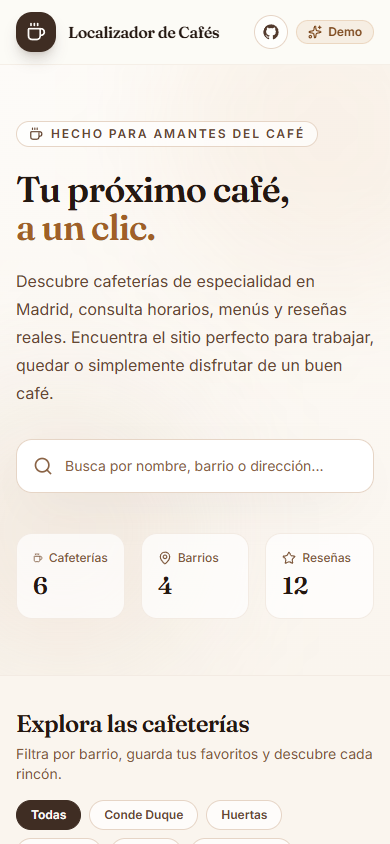

# ☕ Localizador de Cafés

Buscador de cafeterías de especialidad en Madrid. Proyecto **full-stack** pensado como pieza de portafolio: mapa interactivo, filtros por barrio, fichas con menú y horarios, favoritos y reseñas.

**Demo:** _pendiente de publicar en GitHub Pages_ · **API:** ASP.NET Core 8 + PostgreSQL/PostGIS


---

## Sobre el proyecto

El objetivo era construir algo más que una landing: una aplicación real con separación de capas, consultas geoespaciales, validación de datos, estados de carga y error, accesibilidad y un despliegue reproducible.

- **Frontend** React 19 + TypeScript + Vite + Tailwind CSS, con React Query para el estado del servidor.
- **Backend** ASP.NET Core 8 con arquitectura por capas (`Domain`, `Application`, `Infrastructure`, `Api`).
- **Base de datos** PostgreSQL 16 + PostGIS, con columna `geography(Point)` e índice GIST para búsquedas por cercanía.
- **Demo estática** en GitHub Pages: si `VITE_API_URL` está vacío, el frontend usa datos mock y guarda reseñas/favoritos en `localStorage`.

### Funcionalidades

- Búsqueda por nombre, dirección o barrio, insensible a mayúsculas y acentos.
- Filtro por barrio y vista de favoritos persistentes.
- Mapa Leaflet/OpenStreetMap con marcadores sincronizados con el listado.
- Ficha de cafetería: horario, teléfono, enlace a Google Maps, menú y reseñas.
- Formulario de reseñas con validación en cliente y servidor, contador de caracteres y estados de éxito/error.
- Valoración media y número de reseñas actualizados al publicar.
- Diseño responsive (móvil, tablet, escritorio) y navegación por teclado.
- SEO técnico: canonical, Open Graph, Twitter Card, JSON-LD, `robots.txt`, `sitemap.xml` y favicon.
- Estados de carga (skeletons), error con reintento y listas vacías con acción de recuperación.

### Vista móvil



## Stack

| Capa | Tecnología |
| --- | --- |
| Frontend | React 19, TypeScript, Vite 8, Tailwind CSS 3.4, React Query 5 |
| Mapa | Leaflet 1.9 + React Leaflet 5 + OpenStreetMap |
| Backend | .NET 8, ASP.NET Core Web API, EF Core 8, FluentValidation |
| Base de datos | PostgreSQL 16 + PostGIS 3.4 |
| Observabilidad | Serilog, health checks |
| Pruebas | xUnit + FluentValidation.TestHelper |
| Infra | Docker Compose, nginx, GitHub Actions, GitHub Pages |

## Arquitectura

```text
┌──────────────────────────┐        ┌──────────────────────────┐
│  React + Vite (SPA)      │  HTTP  │  ASP.NET Core Web API    │
│  React Query · Leaflet   │ ─────► │  Controllers · Services  │
│  Tailwind · localStorage │        │  FluentValidation        │
└──────────────────────────┘        └────────────┬─────────────┘
                                                 │ EF Core
                                                 ▼
                                    ┌──────────────────────────┐
                                    │  PostgreSQL + PostGIS    │
                                    │  geography(Point) · GIST │
                                    └──────────────────────────┘
```

El backend sigue una arquitectura limpia en cuatro proyectos:

- `Domain`: entidades (`Cafe`, `MenuItem`, `Review`) y reglas de negocio.
- `Application`: DTOs, `CafeService`, validadores e interfaces de repositorio.
- `Infrastructure`: `AppDbContext`, configuraciones EF Core, migraciones, repositorio y seed.
- `Api`: controladores, middleware de errores y cabeceras de seguridad, rate limiting, Swagger, health checks.

## Estructura del repositorio

```text
Localizador_cafes/
├── backend/
│   ├── src/
│   │   ├── LocalizadorCafes.Domain/
│   │   ├── LocalizadorCafes.Application/
│   │   ├── LocalizadorCafes.Infrastructure/
│   │   └── LocalizadorCafes.Api/
│   ├── tests/LocalizadorCafes.UnitTests/
│   ├── Dockerfile
│   └── LocalizadorCafes.sln
├── frontend/
│   ├── src/
│   │   ├── components/
│   │   ├── hooks/
│   │   ├── api/
│   │   ├── data/mockCafes.ts
│   │   └── types/
│   ├── public/
│   ├── Dockerfile
│   ├── nginx.conf
│   └── vite.config.ts
├── docs/screenshots/
├── .github/workflows/
├── docker-compose.yml
└── README.md
```

## Puesta en marcha

### Requisitos

- Node.js 22+
- .NET SDK 8
- PostgreSQL 16 con la extensión PostGIS (o Docker)

### 1. Frontend en modo demo (sin backend)

```bash
cd frontend
npm ci
npm run dev
```

Abre `http://localhost:5173`. Sin `VITE_API_URL`, la app usa los datos de `src/data/mockCafes.ts`; las reseñas y los favoritos se guardan en `localStorage`.

Para probar el build de producción:

```bash
npm run build
npm run preview
```

### 2. Backend + PostgreSQL local

Crea la base de datos y habilita PostGIS:

```sql
CREATE DATABASE localizador_cafes;
\c localizador_cafes
CREATE EXTENSION IF NOT EXISTS postgis;
```

Ajusta la cadena de conexión en `backend/src/LocalizadorCafes.Api/appsettings.json` o con una variable de entorno:

```bash
ConnectionStrings__DefaultConnection="Host=localhost;Port=5432;Database=localizador_cafes;Username=postgres;Password=postgres"
```

Arranca la API (aplica migraciones y seed automáticamente si `Database:AutoMigrate` es `true`):

```bash
cd backend
dotnet run --project src/LocalizadorCafes.Api
```

- API: `http://localhost:5067`
- Swagger (solo Development): `http://localhost:5067/swagger`
- Health check: `http://localhost:5067/health`

Después arranca el frontend apuntando a la API:

```bash
cd frontend
# frontend/.env.local
VITE_API_URL=http://localhost:5067
npm run dev
```

### 3. Docker Compose (todo en uno)

```bash
cp .env.example .env
docker compose up --build
```

- Frontend: `http://localhost:8080`
- API: `http://localhost:5080`
- PostgreSQL/PostGIS: `localhost:5432`

El servicio `db` espera a estar sano antes de arrancar la API; `Database__AutoMigrate=true` crea el esquema y carga los datos de ejemplo.

## Variables de entorno

### Frontend (`frontend/.env.example`)

| Variable | Por defecto | Descripción |
| --- | --- | --- |
| `VITE_API_URL` | vacío | URL de la API. Vacío = modo demo con datos mock. |
| `VITE_SITE_URL` | `https://example.github.io/localizador-cafes/` | URL pública para canonical, Open Graph y sitemap. |
| `VITE_GITHUB_URL` | `https://github.com` | Enlace al repositorio en cabecera y pie. |

### Backend

| Variable | Por defecto | Descripción |
| --- | --- | --- |
| `ConnectionStrings__DefaultConnection` | `Host=localhost;...` | Cadena de conexión a PostgreSQL. |
| `Database__AutoMigrate` | `true` | Aplica migraciones y seed al arrancar. |
| `Cors__AllowedOrigins__0..n` | `localhost:5173`, `localhost:4173` | Orígenes permitidos. |
| `ReverseProxy__TrustForwardedHeaders` | `false` | Activar detrás de un proxy de confianza. |

## API

| Método | Ruta | Descripción |
| --- | --- | --- |
| `GET` | `/api/cafes` | Lista/busca cafeterías. Parámetros: `search`, `lat`, `lng`, `radiusKm`. |
| `GET` | `/api/cafes/{id}` | Ficha completa con menú y reseñas. |
| `POST` | `/api/cafes/{id}/reviews` | Añade una reseña. Limitado a 8 peticiones/minuto por IP. |
| `GET` | `/health` | Estado de la API y la base de datos. |

Ejemplos:

```bash
curl "http://localhost:5067/api/cafes?search=malasa%C3%B1a"
curl "http://localhost:5067/api/cafes?lat=40.4168&lng=-3.7038&radiusKm=3"

curl -X POST "http://localhost:5067/api/cafes/11111111-1111-1111-1111-111111111111/reviews" \
  -H "Content-Type: application/json" \
  -d '{"author":"Ana","rating":5,"comment":"Un café excelente y un ambiente muy tranquilo."}'
```

La validación devuelve `400` con `ValidationProblemDetails`; los parámetros geográficos se comprueban antes de llegar a la base de datos.

### Datos de ejemplo

El seed incluye **6 cafeterías** en 4 barrios de Madrid (Huertas, Malasaña, Palacio, Conde Duque), con menús, horarios y **12 reseñas** iniciales. Los identificadores son deterministas para que los enlaces de ejemplo sean reproducibles.

## Calidad y pruebas

### Backend

```bash
cd backend
dotnet test
```

- 13 pruebas unitarias del validador de reseñas (autor, longitudes, rating y comentario).
- `dotnet build` sin advertencias ni errores.
- Migración EF Core con PostGIS incluida en el repositorio.

### Frontend

```bash
cd frontend
npm run lint
npm run build
```

- TypeScript en modo estricto y build de producción correcto.
- Bundle dividido: app principal ≈ 330 kB (101 kB gzip) y mapa ≈ 155 kB (46 kB gzip) cargado con `React.lazy`.
- CSS ≈ 42 kB (12 kB gzip).

### Auditoría Lighthouse (build de producción)

| Categoría | Puntuación |
| --- | --- |
| Accessibility | **100** |
| Best Practices | **100** |
| SEO | **100** |

Comprobaciones manuales realizadas:

- Responsive a 390 px, 768 px, 1024 px y 1440 px sin desbordamientos horizontales.
- Navegación por teclado: skip link, foco visible, tabs con flechas, formulario con foco en el primer error.
- Contraste de texto corregido (AA) y atributos ARIA válidos.
- Estados de carga, error, vacío y reintento probados.
- Búsqueda con acentos (`malasaña` → `Malasaña`), filtros combinados, favoritos y publicación de reseñas.
- Cabeceras de seguridad en API (`X-Content-Type-Options`, `X-Frame-Options`, `Referrer-Policy`, `Permissions-Policy`, CSP) y CSP en el HTML estático.
- Rate limiting en reseñas y validación de parámetros de búsqueda.

## Despliegue en GitHub Pages

El workflow `.github/workflows/deploy-pages.yml` compila el frontend y publica `frontend/dist` en Pages en cada push a `main`.

1. Sube el repositorio a GitHub.
2. En **Settings → Pages**, selecciona **GitHub Actions** como origen.
3. El workflow calcula `VITE_SITE_URL` a partir del nombre del repositorio y `VITE_GITHUB_URL` a partir del remoto.
4. Opcional: define el variable `SITE_URL` en **Settings → Secrets and variables → Actions** si usas un dominio propio.

Con `base: './'` los assets funcionan tanto en la raíz como en una subruta de proyecto (`usuario.github.io/repo/`).

El workflow `.github/workflows/backend.yml` compila y ejecuta las pruebas del backend en cada push o pull request que afecte a `backend/`.

## Limitaciones conocidas

- La demo de GitHub Pages funciona en **modo mock**: no hay backend público, por lo que las reseñas se guardan solo en el navegador.
- El backend no se ha ejecutado contra una instancia real de PostgreSQL en el entorno de desarrollo local (no había Docker/PostgreSQL instalados); sí compila, pasa las pruebas y la migración está generada. El `docker-compose.yml` permite validarlo de extremo a extremo.
- El mapa depende de OpenStreetMap; sin conexión, los tiles no cargan (el resto de la interfaz sigue funcionando).
- `VITE_SITE_URL` y `VITE_GITHUB_URL` deben sustituirse por las URLs reales antes de publicar.

## Licencia

Proyecto de portafolio. Los datos de cafeterías son ficticios y se usan solo como demostración.
