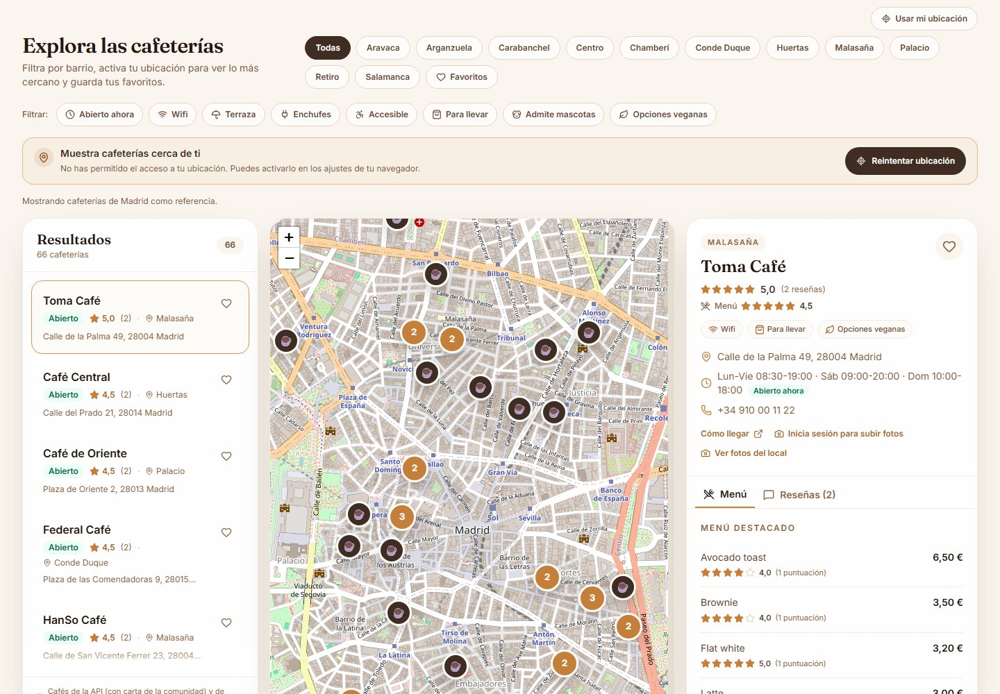
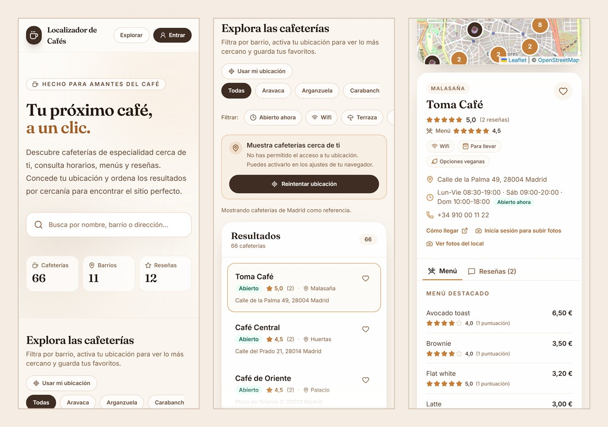

<div align="center">

# ☕ Localizador de Cafés

**Encuentra cafeterías cerca de ti, consulta su carta y comparte tu opinión.**

Aplicación web full-stack con geolocalización, mapa interactivo, cuentas de usuario,
carta colaborativa moderada y panel de administración en tiempo real.

[](https://github.com/Portu142/LocalizadorCafeterias/actions/workflows/backend.yml)
[](https://github.com/Portu142/LocalizadorCafeterias/actions/workflows/deploy-pages.yml)


[**Demo en vivo**](https://portu142.github.io/LocalizadorCafeterias/) ·
[Funcionalidades](#-funcionalidades) ·
[Puesta en marcha](#-puesta-en-marcha) ·
[API](#-api) ·
[Arquitectura](#-arquitectura)



</div>

> [!NOTE]
> La demo de GitHub Pages es **estática** (sin backend): muestra cafeterías reales de OpenStreetMap
> cerca de ti, pero las cuentas, la carta colaborativa, la subida de fotos y el panel de administración
> necesitan la API. Consulta [Puesta en marcha](#-puesta-en-marcha) para ejecutarlo todo en local.

## Índice

- [Funcionalidades](#-funcionalidades)
- [Capturas](#-capturas)
- [Stack tecnológico](#-stack-tecnológico)
- [Arquitectura](#-arquitectura)
- [Puesta en marcha](#-puesta-en-marcha)
- [Configuración](#-configuración)
- [API](#-api)
- [Panel de administración](#-panel-de-administración)
- [Seguridad](#-seguridad)
- [Calidad y pruebas](#-calidad-y-pruebas)
- [Despliegue](#-despliegue)
- [Limitaciones conocidas](#-limitaciones-conocidas)
- [Créditos y licencia](#-créditos-y-licencia)

## Funcionalidades

### Para quien busca café

- **Cerca de mí**: pide la ubicación al cargar, busca en un radio de 5 km, ordena por distancia y centra el mapa en tu posición. Si deniegas el permiso, muestra cafeterías de Madrid como referencia y permite reintentarlo.
- **Cobertura en cualquier ciudad**: combina las cafeterías de la base de datos con las de **OpenStreetMap** de tu zona, sin duplicados.
- **Búsqueda y filtros combinables**: por nombre, dirección o barrio (sin distinguir mayúsculas ni acentos), por barrio, «Abierto ahora» (interpreta el horario de OSM o de la API) y servicios como wifi, terraza, enchufes, accesible, para llevar, mascotas u opciones veganas.
- **Mapa interactivo** con Leaflet: marcadores agrupados, sincronizados con el listado, y botón «Centrar en mí».
- **Ficha completa**: horario con estado en vivo, teléfono, cómo llegar, servicios, fotos con autor y licencia, carta y reseñas.
- **Favoritos** guardados en el navegador, independientes de la ubicación.

### Para la comunidad (con la API)

- **Cuentas** con ASP.NET Identity: registro, inicio de sesión y sesión en cookie HttpOnly.
- **Reseñas** con puntuación global y **puntuación por plato**; la ficha muestra la media de cada plato y del menú.
- **Carta colaborativa**: cualquier usuario puede proponer platos y precios en cualquier cafetería, también en las de OpenStreetMap (se importan a la base de datos con su primera aportación).
- **Subida de fotos** (JPEG, PNG o WebP de hasta 5 MB, validadas por su contenido).
- **Moderación**: los platos y fotos quedan pendientes hasta que un administrador los aprueba; su autor los ve con la etiqueta «Pendiente de revisión».
- **Mis reseñas**: historial de lo que has publicado.

### Para administración

- **Panel web en `/admin`** con estadísticas, moderación, gestión de cafeterías y usuarios, actividad de la comunidad, registro de auditoría y visitantes **en vivo**. [Más detalles](#-panel-de-administración).

### Calidad de producto

- Diseño responsive (de 390 px a escritorio), navegación por teclado y contraste AA.
- Estados de carga (skeletons), error con reintento y vacíos con acción de recuperación.
- SEO técnico: títulos y meta descripciones, canonical, Open Graph, Twitter Card, JSON-LD, `robots.txt` y `sitemap.xml`.

## Capturas

<div align="center">



</div>

## Stack tecnológico

| Capa | Tecnología |
| --- | --- |
| **Frontend** | React 19, TypeScript (estricto), Vite 8, Tailwind CSS 3.4, TanStack React Query 5, lucide-react |
| **Mapa** | Leaflet 1.9, React Leaflet 5, Leaflet.markercluster, teselas de OpenStreetMap |
| **Backend** | .NET 8, ASP.NET Core Web API + Razor Pages (panel), EF Core 8, FluentValidation, ASP.NET Identity |
| **Base de datos** | PostgreSQL 16 + PostGIS 3.4 (`geography(Point)` con índice GIST) vía Npgsql + NetTopologySuite |
| **Observabilidad** | Serilog, health checks |
| **Pruebas** | xUnit, FluentValidation.TestHelper, ESLint, `tsc` |
| **Infraestructura** | Docker Compose, nginx, GitHub Actions, GitHub Pages, Cloudflare Tunnel (opcional) |

## Arquitectura

```text
┌───────────────────────────┐   HTTP + cookie   ┌──────────────────────────────┐
│  SPA React + Vite         │ ────────────────► │  ASP.NET Core 8              │
│  React Query · Leaflet    │                   │  Web API  ·  Panel /admin    │
│  Tailwind                 │                   │  Identity · Rate limiting    │
└─────────────┬─────────────┘                   └──────────────┬───────────────┘
              │ Photon / Overpass                              │ EF Core
              ▼                                                ▼
┌───────────────────────────┐                   ┌──────────────────────────────┐
│  OpenStreetMap            │ ◄──── import ──── │  PostgreSQL + PostGIS        │
│  cafeterías del mundo     │                   │  cafés · cartas · reseñas    │
└───────────────────────────┘                   └──────────────────────────────┘
```

El backend sigue una **arquitectura limpia** en cuatro proyectos:

| Proyecto | Responsabilidad |
| --- | --- |
| `Domain` | Entidades (`Cafe`, `MenuItem`, `Review`, fotos), estados de moderación y reglas de negocio. |
| `Application` | DTOs, servicios (`CafeService`, administración), validadores e interfaces de repositorio. |
| `Infrastructure` | `AppDbContext`, configuraciones y migraciones EF Core, Identity, repositorios, importación desde OSM y seed. |
| `Api` | Controladores, panel Razor Pages, autenticación, presencia en tiempo real, cabeceras de seguridad, rate limiting y Swagger. |

<details>
<summary><strong>Estructura del repositorio</strong></summary>

```text
.
├── backend/
│   ├── src/
│   │   ├── LocalizadorCafes.Domain/
│   │   ├── LocalizadorCafes.Application/
│   │   ├── LocalizadorCafes.Infrastructure/
│   │   └── LocalizadorCafes.Api/          # API + panel /admin (Pages/Admin, wwwroot/admin)
│   └── tests/LocalizadorCafes.UnitTests/
├── frontend/                               # SPA React + Vite
│   ├── public/                             # robots.txt, iconos y manifest (el sitemap se genera al compilar)
│   └── src/                                # components, hooks, lib, api
├── docs/screenshots/
├── scripts/                                # dev.ps1, start-db.ps1
├── .github/workflows/                      # backend.yml, deploy-pages.yml
└── docker-compose.yml
```

</details>

## Puesta en marcha

### Requisitos

- [Node.js](https://nodejs.org/) 20.19+ o 22.12+ (requisito de Vite 8)
- [.NET SDK 8](https://dotnet.microsoft.com/download/dotnet/8.0)
- PostgreSQL 16 + PostGIS 3.4 (**opcional**: sin base de datos, la API arranca con datos de ejemplo en memoria)
- O bien, solo [Docker](https://www.docker.com/)

### Opción A · Docker Compose (todo en uno)

```bash
cp .env.example .env
docker compose up --build
```

| Servicio | URL |
| --- | --- |
| Frontend | http://localhost:8080 |
| API | http://localhost:5080 |
| PostgreSQL/PostGIS | `localhost:5432` |

La API espera a que la base de datos esté lista, aplica las migraciones y carga los datos de ejemplo.

### Opción B · Script de desarrollo (Windows)

```powershell
.\scripts\dev.ps1
```

Arranca PostgreSQL en WSL, la API y el frontend en ventanas separadas y abre http://localhost:5173.
Opciones: `-SkipDatabase` y `-SkipBrowser`. Si la política de ejecución lo bloquea:
`powershell -ExecutionPolicy Bypass -File .\scripts\dev.ps1`.

### Opción C · Paso a paso

```bash
# 1. API (http://localhost:5067 · Swagger en /swagger · health check en /health)
cd backend
dotnet run --project src/LocalizadorCafes.Api

# 2. Frontend apuntando a la API (en otra terminal)
cd frontend
npm ci
echo "VITE_API_URL=http://localhost:5067" > .env.development.local
npm run dev
```

Abre http://localhost:5173. Sin `VITE_API_URL`, el frontend funciona en **modo demo**, solo con OpenStreetMap.

<details>
<summary><strong>Preparar PostgreSQL + PostGIS</strong></summary>

En Windows, lo más rápido es WSL con Ubuntu:

```powershell
# Instalación (una sola vez)
wsl -d Ubuntu-24.04 -u root -- bash -lc "apt-get install -y postgresql postgresql-contrib postgis postgresql-16-postgis-3"

# Arrancar el clúster y mantenerlo vivo
.\scripts\start-db.ps1          # o: .\scripts\start-db.ps1 -Distro Ubuntu
```

Con cualquier otra instalación (nativa o Docker), crea la base de datos y habilita PostGIS:

```sql
CREATE DATABASE localizador_cafes;
\c localizador_cafes
CREATE EXTENSION IF NOT EXISTS postgis;
```

Con `Database:AutoMigrate=true` (por defecto), la API aplica las migraciones y el seed al arrancar.

</details>

<details>
<summary><strong>Builds de producción y túnel público</strong></summary>

| Comando | Resultado |
| --- | --- |
| `npm run build` | Demo estática (GitHub Pages): sin API, solo OpenStreetMap. |
| `npm run build:tunnel` | Build con la API en el **mismo origen** (`VITE_API_URL=same-origin`). |

Para compartir la versión completa desde tu equipo con [Cloudflare Tunnel](https://developers.cloudflare.com/cloudflare-one/connections/connect-networks/):

```powershell
cd frontend
npm run build:tunnel
npm run preview -- --port 4173

# En otra terminal
cloudflared tunnel --url http://localhost:4173 --no-autoupdate
```

El proxy de `vite preview` reenvía `/api`, `/health` y `/admin` a la API, con las cabeceras del cliente real
(`X-Forwarded-For`, `X-Forwarded-Proto`), para que la limitación de peticiones y las cookies `Secure` funcionen tras el túnel.

</details>

> [!TIP]
> En Windows, para recompilar la API hay que pararla antes (`Ctrl+C`): el proceso en marcha bloquea sus `.dll` y la compilación falla con `MSB3027`.

## Configuración

### Frontend (`frontend/.env.example`)

| Variable | Por defecto | Descripción |
| --- | --- | --- |
| `VITE_API_URL` | *(vacío)* | URL de la API. Vacío: modo demo solo con OpenStreetMap. `same-origin`: API servida en el mismo origen. |
| `VITE_SITE_URL` | `https://portu142.github.io/LocalizadorCafeterias/` | URL pública para canonical, Open Graph y sitemap. |

### Backend (`appsettings.json`, variables de entorno o user-secrets)

| Clave (variable de entorno) | Por defecto | Descripción |
| --- | --- | --- |
| `ConnectionStrings__DefaultConnection` | `Host=127.0.0.1;…` | Cadena de conexión a PostgreSQL. |
| `Database__AutoMigrate` | `true` | Aplica migraciones y seed al arrancar. |
| `Database__AllowInMemoryFallback` | `true` | Sin PostgreSQL, arranca con datos de ejemplo en memoria. |
| `Cors__AllowedOrigins__0..n` | `localhost:5173`, `localhost:4173`, … | Orígenes permitidos para el frontend. |
| `ReverseProxy__TrustForwardedHeaders` | `false` | Confiar en cabeceras `X-Forwarded-*` de proxies externos (por defecto, solo desde loopback). |
| `Admin__Emails__0..n` | *(vacío)* | Emails que reciben el rol de administrador al iniciar sesión. |
| `Admin__InitialEmail` | `admin@localizador.local` | Email del administrador inicial. |
| `Admin__CreateInitialAdmin` | `true` | Crea el administrador inicial si no existe ninguno. |
| `Storage__AppDataPath` | `App_Data` | Carpeta de fotos subidas, claves de Data Protection y credenciales iniciales. |

> [!IMPORTANT]
> No guardes secretos en el repositorio. En desarrollo usa `dotnet user-secrets`; en Docker o producción, variables de entorno.
> La carpeta `App_Data/` está excluida de git.

## API

Documentación interactiva en `/swagger` (entorno Development). Las peticiones de escritura requieren sesión.

<details open>
<summary><strong>Cafeterías y contenido</strong></summary>

| Método | Ruta | Descripción |
| --- | --- | --- |
| `GET` | `/api/cafes` | Lista o busca cafeterías. Parámetros: `search`, `lat`, `lng`, `radiusKm`. |
| `GET` | `/api/cafes/{id}` | Ficha completa con carta, fotos y reseñas. |
| `POST` | `/api/cafes/import` | Importa un café de OpenStreetMap (`{"osmId":"node/123"}`) o devuelve el ya guardado. 🔒 |
| `POST` | `/api/cafes/{id}/reviews` | Publica una reseña con puntuación global y por plato. 🔒 |
| `POST` | `/api/cafes/{id}/menu` | Propone un plato (`name`, `price` de 0,01 a 500 €). Queda pendiente de moderación. 🔒 |
| `DELETE` | `/api/cafes/{id}/menu/{itemId}` | Borra un plato propio si nadie más lo ha puntuado. 🔒 |
| `POST` | `/api/cafes/{id}/photos` | Sube una foto (`multipart/form-data`, campo `photo`). Queda pendiente de moderación. 🔒 |
| `GET` | `/api/photos/{fileName}` | Sirve una foto subida. |

</details>

<details>
<summary><strong>Cuenta y presencia</strong></summary>

| Método | Ruta | Descripción |
| --- | --- | --- |
| `POST` | `/api/auth/register` | Crea una cuenta e inicia sesión. |
| `POST` | `/api/auth/login` | Inicia sesión (bloqueo temporal tras varios intentos fallidos). |
| `POST` | `/api/auth/logout` | Cierra la sesión. |
| `GET` | `/api/auth/me` | Usuario actual, o `204 No Content` si no hay sesión. |
| `GET` | `/api/me/reviews` | Reseñas del usuario actual. 🔒 |
| `POST` | `/api/presence` | Latido anónimo para «En vivo» del panel (id aleatorio por sesión del navegador). |

</details>

<details>
<summary><strong>Administración</strong> (rol Admin)</summary>

| Método | Ruta | Descripción |
| --- | --- | --- |
| `GET` | `/api/admin/pending` | Platos y fotos pendientes de revisión. |
| `POST` | `/api/admin/dishes/{id}/approve` · `/reject` | Aprueba o rechaza un plato. |
| `POST` | `/api/admin/photos/{id}/approve` · `/reject` | Aprueba o rechaza una foto. |
| `GET` | `/api/admin/reviews` | Últimas reseñas. |
| `DELETE` | `/api/admin/reviews/{id}` | Borra una reseña. |

</details>

Requiere sesión iniciada.

## Panel de administración

El backend sirve un panel web en **`/admin`** (por ejemplo, http://localhost:5067/admin), con su propio inicio de sesión:

| Sección | Qué permite |
| --- | --- |
| **En vivo** | Personas usando la web ahora (con y sin cuenta), visitantes por minuto y cafeterías que se están viendo. Se actualiza cada 5 s. |
| **Resumen** | Pendientes, totales y gráficas semanales de cuentas, reseñas, platos y fotos. |
| **Platos y fotos** | Filtrar por estado, aprobar, rechazar, ocultar, restaurar, editar y borrar. |
| **Reseñas** | Búsqueda por texto, autor o cafetería, y borrado. |
| **Cafeterías** | Editar datos y servicios, y gestionar la carta, las fotos y las reseñas de cada una. |
| **Usuarios** | Dar o quitar el rol de administrador, suspender y reactivar cuentas, borrarlas y ver su actividad. |
| **Actividad** | Lo que hace la comunidad y un **registro de auditoría** inmutable de las acciones del panel. |

**Primer acceso.** Si no hay ningún administrador, la API crea `admin@localizador.local` con una contraseña aleatoria y la guarda. Ese archivo está excluido de git y la contraseña nunca se escribe en el log. Entra, cambia la contraseña desde el panel y borra el archivo.

Para dar el rol de administrador a otra cuenta, hazlo desde **Usuarios** o con user-secrets:

```bash
dotnet user-secrets set "Admin:Emails:0" "tu-email@ejemplo.com" --project backend/src/LocalizadorCafes.Api
```

## Seguridad

- **Sesión** en cookie `HttpOnly`, `SameSite=Lax` y `Secure` sobre HTTPS: el frontend nunca maneja tokens.
- **Contraseñas** gestionadas por ASP.NET Identity, con bloqueo tras varios intentos fallidos y el mismo mensaje para un email inexistente o una contraseña errónea.
- **Rate limiting** por cliente real: inicio de sesión y registro, reseñas (8/min), aportaciones (30/h), fotos (20/h) y presencia.
- **Validación** en cliente y servidor (FluentValidation); las fotos se validan por su contenido, no por la extensión.
- **Moderación previa** de platos y fotos de la comunidad.
- **Panel**: solo rol Admin, tokens antifalsificación, CSP estricta sin JavaScript en línea, `X-Frame-Options: DENY` y sin caché.
- **Cabeceras de seguridad** en la API y en el frontend: CSP, `X-Content-Type-Options`, `Referrer-Policy` y `Permissions-Policy`.
- **Privacidad**: la presencia usa un id aleatorio por sesión del navegador, no guarda IPs y caduca en minutos.

## Calidad y pruebas

```bash
# Backend: 79 pruebas unitarias (xUnit)
cd backend
dotnet test

# Frontend: lint + comprobación de tipos + build de producción
cd frontend
npm run lint
npm run build
```

- **Pruebas del backend**: validación de reseñas, servicio de cafeterías, carta colaborativa, moderación, subida de fotos, panel de administración, presencia en tiempo real y repositorio en memoria.
- **Frontend**: TypeScript estricto, ESLint y un bundle dividido. La app principal pesa ≈ 354 kB (107 kB gzip). El mapa (≈ 190 kB, 55 kB gzip) y los diálogos de cuenta se cargan bajo demanda.
- **Probado contra PostgreSQL 16 + PostGIS 3.4 reales**: migraciones, seed, búsqueda por radio con `geography`, reseñas, importación desde OSM y moderación.
- **Comprobaciones manuales**: responsive a 390, 768, 1024 y 1440 px, navegación por teclado, estados de carga, error y vacío, flujo de geolocalización completo y compatibilidad entre navegadores.

## Despliegue

| Workflow | Disparador | Qué hace |
| --- | --- | --- |
| [`backend.yml`](.github/workflows/backend.yml) | Push o PR que afecte a `backend/`, o manual | Compila y ejecuta las pruebas del backend. |
| [`deploy-pages.yml`](.github/workflows/deploy-pages.yml) | Push a `main`, o manual | Compila la demo estática y la publica en GitHub Pages. |

Para activar GitHub Pages en un fork, ve a **Settings → Pages** y elige **GitHub Actions** como origen. El workflow calcula `VITE_SITE_URL` a partir del nombre del repositorio. Si usas un dominio propio, define la variable `SITE_URL` en **Settings → Secrets and variables → Actions**.

## Limitaciones conocidas

- **OpenStreetMap no publica cartas**: las cafeterías sin carta de la comunidad enlazan a la web del local o a su ficha de Google Maps.
- **Los datos de ejemplo cubren Madrid**. En otras ciudades se muestran las cafeterías de OpenStreetMap, que se incorporan a la base de datos cuando alguien aporta algo.
- **La presencia «En vivo» vive en memoria**: se reinicia con la API y no está pensada para varias instancias.
- **La geolocalización** requiere HTTPS (o `localhost`) y el permiso del usuario.
- **Las teselas del mapa** necesitan conexión; sin ella, el resto de la interfaz sigue funcionando.

## Créditos y licencia

- Datos de cafeterías © [colaboradores de OpenStreetMap](https://www.openstreetmap.org/copyright), bajo licencia [ODbL](https://opendatacommons.org/licenses/odbl/). Búsqueda con [Photon](https://photon.komoot.io/) y [Overpass API](https://overpass-api.de/).
- Fotos de [Wikimedia Commons](https://commons.wikimedia.org/), con autor y licencia indicados en cada imagen.
- Mapa con [Leaflet](https://leafletjs.com/) e iconos de [Lucide](https://lucide.dev/).

Este repositorio es un proyecto de portafolio y **todavía no incluye un archivo de licencia**: mientras no se añada, se aplican los derechos de autor por defecto.
